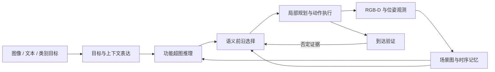

# Tempo-HyperNav

**Temporal Scene Memory and Functional Hypergraph Reasoning for Zero-shot Goal Navigation**

Tempo-HyperNav 是基于 [UniGoal](https://github.com/bagh2178/UniGoal) 扩展的零样本目标导航研究项目。它将**时序场景记忆、功能超图推理和带反馈的前沿选择**结合起来，让智能体在探索未知室内环境时，持续更新“看到了什么、哪些关系仍然可信、下一步去哪里寻找目标”。

项目支持图像、文本和物体类别目标，并提供实验性的 GOAT 连续子目标适配，以及本地 Web 监控界面。导航使用预训练感知模型与 LLM/VLM，无需针对导航任务额外训练策略。

> 当前发布为研究实现，数据集、模型权重和完整 GPU 环境需另行准备。安装部分列出了依赖和已知兼容性问题；本仓库尚未完成全新环境下的端到端复现。

## 相对 UniGoal 的主要扩展

统一目标图、多模态目标表达、基础场景建图和分阶段探索沿用 UniGoal。下面列出本项目在这些基础上的扩展及其代码入口。

| 扩展 | 解决的问题与实现 | 代码入口 |
| --- | --- | --- |
| **时序场景记忆** | 保存对象首次/最近观测、观测次数与置信度历史；结合时间衰减和观测证据筛选活跃节点；维护关系的 pending / active / rejected 状态，按可见性条件衰减关系权重 | [graph.py](src/graph/graph.py) |
| **功能超图推理** | 将多个物体组成的功能关系表示为超边，结合目标与上下文匹配、时序置信度和关系证据，通过带阻尼的近似置信传播评估场景节点 | [hypergraph_bp.py](src/reasoning/hypergraph_bp.py) |
| **语义边界预检** | 用当前视角的区域语义和缓存位置，为不相关区域附近的前沿施加软惩罚；结合通道处理，辅助决定是否继续进入该区域 | [graph.py](src/graph/graph.py) 中的 `doorway_peek` |
| **前沿信念与到达反馈** | 增加有界的前沿效用项，融合正负证据与距离代价；将到达验证的否定结果反馈给后续探索，抑制重复追逐错误候选 | [frontier_belief.py](src/utils/frontier_belief.py)、[agent.py](src/agent/unigoal/agent.py) |

这些机制形成“观测—记忆—推理—行动—验证”的闭环。它们的设计目标是改善证据利用和探索决策，实际性能需要在统一评测协议下通过 baseline 与消融实验验证。

实现上，时序置信度采用启发式加权与 sigmoid 更新；超图推理采用近似的标量消息传播。`compute_clip_similarity` 虽沿用该函数名，当前实现实际基于文本词项匹配。语义边界预检使用当前画面，并非独立的几何门检测器；新增前沿效用与原有评分项共同参与决策。

## 导航流程



GOAT 适配在切换子目标时复用场景和地图记忆，并重置目标相关状态，入口为 [goat_env.py](src/envs/goat_env.py) 与 [goat_episode_parser.py](src/envs/goat_episode_parser.py)。Web 界面用于任务提交、日志查看和场景图调试。

## 环境与安装

历史运行环境以 Linux、NVIDIA GPU、Python 3.8、Habitat-Sim 0.2.3 和仓库内的 Habitat-Lab 0.2.3 为基础。PyTorch、CUDA 和编译型依赖需要选择相互兼容的版本。

```bash
git clone https://github.com/Allencc5658/Tempo-HyperNav.git
cd Tempo-HyperNav
conda create -n tempo-hypernav python=3.8
conda activate tempo-hypernav
conda install habitat-sim=0.2.3 -c conda-forge -c aihabitat
# 先安装与本机 CUDA 匹配的 PyTorch，再安装项目依赖
pip install -r third_party/habitat-lab/requirements.txt
pip install -e third_party/habitat-lab
pip install -r requirements.txt
```

还需要 LightGlue、Detectron2、PyTorch3D、FAISS 和 Grounded-Segment-Anything。以下命令列出依赖来源；未指定 revision 的依赖尚未锁定，不能保证其最新版本与上述历史环境兼容。

```bash
pip install git+https://github.com/cvg/LightGlue.git
pip install git+https://github.com/facebookresearch/detectron2.git
pip install git+https://github.com/facebookresearch/pytorch3d.git
conda install pytorch::faiss-gpu
git clone https://github.com/IDEA-Research/Grounded-Segment-Anything.git third_party/Grounded-Segment-Anything
cd third_party/Grounded-Segment-Anything
git checkout 5cb813f
pip install -e segment_anything
pip install --no-build-isolation -e GroundingDINO
cd ../..
```

**已知接口兼容项：** 当前 [graph.py](src/graph/graph.py) 调用的 Grounded-SAM `load_model` 接收额外的本地 BERT 路径，并将返回值作为序列取首项；而上述 [Grounded-SAM 原始文件](https://github.com/IDEA-Research/Grounded-Segment-Anything/blob/5cb813f/grounded_sam_demo.py) 接收配置、权重、设备并直接返回模型。首次运行前需对齐这一加载接口；仅执行依赖安装命令尚不足以启动导航。

## 数据与模型准备

按任务准备 HM3D 场景、对应 episode 数据和视觉模型权重。默认路径如下；场景与 episode 的版本需与所选 YAML 保持一致。

```text
data/
├── models/
│   ├── sam_vit_h_4b8939.pth
│   ├── groundingdino_swint_ogc.pth
│   └── bert-base-uncased/
├── scene_datasets/hm3d_v0.2/val/
└── datasets/
    ├── instance_imagenav/hm3d/v3/val/
    ├── objectnav/hm3d/v2/val/
    ├── textnav/val/val_text.json.gz
    └── goat_bench/hm3d/v1/<split>/<split>.json.gz
```

数据和权重获取可参考 [UniGoal 安装说明](https://github.com/bagh2178/UniGoal#installation)与对应模型项目。它们不包含在本仓库中；使用时遵守各自许可和数据访问条件。

### LLM / VLM 服务

通过 OpenAI 兼容接口访问模型。示例 YAML 使用本地服务与 `llama2:7b`、`llava:7b`；请先启动能够提供对应模型的服务，或替换为实际部署的模型。

```bash
export UNIGOAL_BASE_URL="http://localhost:11434/v1/"
export UNIGOAL_LLM_MODEL="llama2:7b"
export UNIGOAL_VLM_MODEL="llava:7b"
export UNIGOAL_API_KEY="EMPTY"  # 本地服务占位值
```

四个环境变量的非空值优先于 YAML 中的模型配置。为兼容现有代码，环境变量继续使用 `UNIGOAL_` 前缀。远程服务凭据通过环境变量注入，不写入受版本控制的文件；程序不会自动加载 `.env`。

## 运行导航

在项目根目录执行。先在所选 YAML 中设置 `num_eval_episodes`、`experiment_id`、`dump_location` 和任务数据路径；首次验证可将 `num_eval_episodes` 设为 `1`。

```bash
# 图像目标导航
python main.py --goal_type ins-image --config-file configs/config_habitat.yaml
# 文本目标导航
python main.py --goal_type text --config-file configs/config_textnav.yaml
# 物体类别目标导航
python main.py --goal_type objnav --config-file configs/config_objnav.yaml
# GOAT 连续子目标导航（实验性），运行一个 episode
python main.py --goal_type goat --config-file configs/config_goat_unigoal.yaml --goat_split val_unseen --episode_id 0
```

| 配置 / 参数 | 用途 |
| --- | --- |
| `configs/config_objnav_2022.yaml` / `configs/config_objnav_2023.yaml` | 对应不同年份的 ObjectNav 任务配置；需分别核对数据、传感器和步数预算 |
| `--goat_split` | GOAT 支持 `val_seen`、`val_seen_synonyms`、`val_unseen` |
| `--resume` | 从当前实验输出目录中的检查点恢复；应保持相同配置 |
| `--goal` | 传入自定义图像目标路径或文本目标，需与 `goal_type` 配合使用 |
| `--web_output_dir` | 导出用于 Web 调试的帧和场景图快照 |

配置优先级为：参数默认值 → YAML → 显式 CLI 参数；模型环境变量最后覆盖。`experiment_id` 和 `num_eval_episodes` 通过 YAML 设置。输出默认写入 `outputs/experiments/<experiment_id>/`，包含日志、可视化及运行生成的诊断信息。

## Baseline 与消融

| 变体 | 运行方式 / 附加参数 | 对比内容 |
| --- | --- | --- |
| 原版 UniGoal | 独立使用上游源码，并记录 commit | 原方法与扩展实现的整体对比 |
| Full | 默认开启增强机制 | 当前完整实现 |
| w/o Temporal | `--disable_temporal` | 关闭时序增强 |
| w/o Hypergraph | `--disable_hypergraph` | 关闭超图推理，回退到图重叠匹配 |
| w/o Peek | `--disable_peek` | 关闭语义边界预检 |
| w/o Arrival Feedback | `--disable_arrival_reject` | 关闭到达否定证据向前沿的反馈，保留到达验证 |
| w/o Frontier Belief | `--disable_frontier_belief` | 关闭新增的有界前沿效用项 |

例如，在独立配置中设置新的 `experiment_id` 后，可运行去除时序增强的变体：

```bash
cp configs/config_habitat.yaml configs/config_ablation_temporal.yaml
# 编辑新配置：设置独立的 experiment_id，并保持其他实验条件一致
python main.py --goal_type ins-image --config-file configs/config_ablation_temporal.yaml --disable_temporal
```

各组固定数据版本、split、episode 列表、模型、传感器、步数预算与成功定义，分别保存配置和逐 episode 结果，再统计 SR / SPL。关闭所有开关后的当前实现仍含有其他修复和任务适配，不能替代原版 UniGoal baseline。

本仓库提供实验入口，尚未发布与当前 commit 完整绑定的 benchmark 结果表。GOAT 当前成功判定使用最终位置到目标 viewpoints 的最小测地距离，`config_goat_unigoal.yaml` 的阈值为 0.25 m，且不要求 STOP；比较结果时应明确这一评测协议。

## 可选：本地 Web 界面

后端使用能够运行导航的同一 Python 环境；模型环境变量应在启动后端前设置。另需准备与前端 Vite 依赖兼容的 Node.js 和 npm。

```bash
# 终端 1：在项目根目录执行
pip install -r web/backend/requirements.txt
cd web/backend
uvicorn app.main:app --host 127.0.0.1 --port 8000
```

```bash
# 终端 2：在项目根目录执行
cd web/frontend
npm install
npm run dev -- --host 127.0.0.1
```

访问 `http://localhost:3000`。服务会创建 `web/storage/`；初次启动没有目标目录时，任务列表为空。根据已安装的 episode 数据创建 `web/storage/goal_catalog.json`，结构如下，示例 ID 和场景需替换为真实条目：

```json
[
  {
    "id": "example-object-episode",
    "display_name": "Example object navigation episode",
    "goal_type": "objnav",
    "episode_id": 0,
    "scene_id": "replace-with-dataset-scene"
  }
]
```

界面支持 `ins-image`、`text`、`objnav`，以及 Temporal / Hypergraph / Peek 三个消融选项；GOAT 和其他消融参数使用 CLI。展示字段不会替换数据集中的实际目标。此界面无认证，仅用于本地环境；运行目录可由后端静态路由访问，应通过环境变量传入凭据。

## 代码结构

```text
main.py                  导航与评测入口
configs/                 任务、传感器和模型配置
src/graph/               场景图、时序记忆和前沿选择
src/reasoning/           功能超图与近似置信传播
src/agent/               动作控制和到达验证
src/envs/                Habitat 与 GOAT 任务适配
src/map/                 地图构建
src/utils/               前沿效用、配置和诊断工具
web/backend/             FastAPI 任务与监控服务
web/frontend/            React 可视化界面
third_party/habitat-lab/  Habitat-Lab 0.2.3 源码
```

核心运行依赖外部数据和模型服务。Web 的部分图快照字段仍为占位信息；真实机器人接口也需要设备侧实现，当前发布主要面向 Habitat 仿真研究。

## 来源与许可

本项目基于 [UniGoal 原始实现](https://github.com/bagh2178/UniGoal)，保留其 [MIT 许可证](LICENSE)和版权声明。仓库内 Habitat-Lab 遵循其[独立许可证](third_party/habitat-lab/LICENSE)。其他依赖、模型与数据集遵循各自许可。

使用 UniGoal 的方法或代码时，请引用[原论文](https://arxiv.org/abs/2503.10630)：

```bibtex
@article{yin2025unigoal,
  title={UniGoal: Towards Universal Zero-shot Goal-oriented Navigation},
  author={Hang Yin and Xiuwei Xu and Linqing Zhao and Ziwei Wang and Jie Zhou and Jiwen Lu},
  journal={arXiv preprint arXiv:2503.10630},
  year={2025}
}
```
